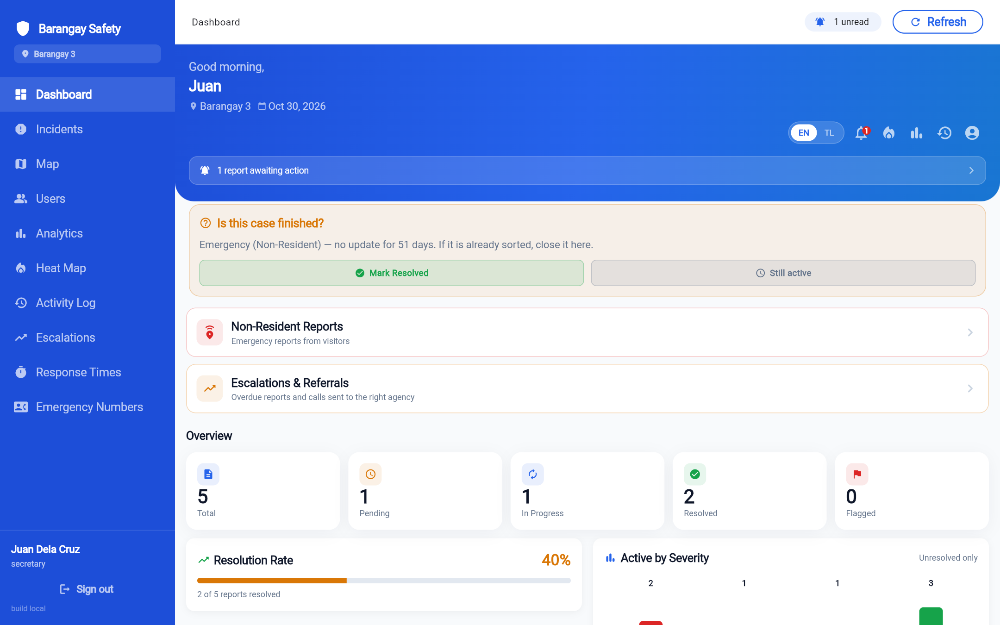
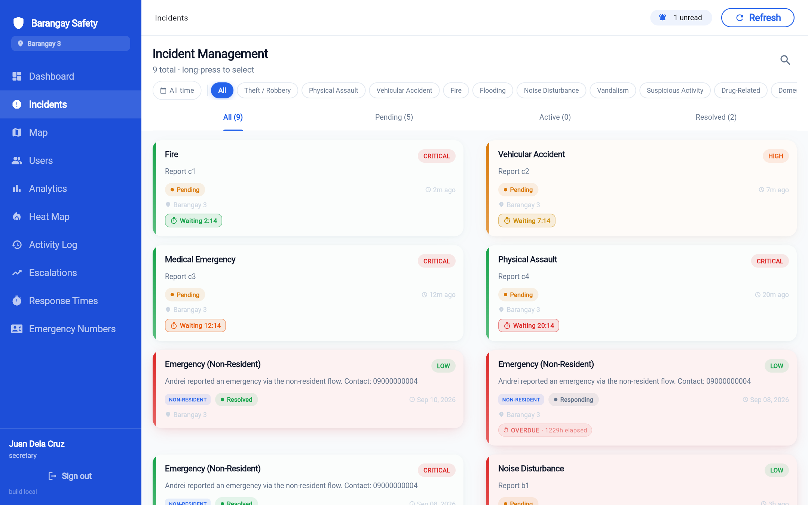
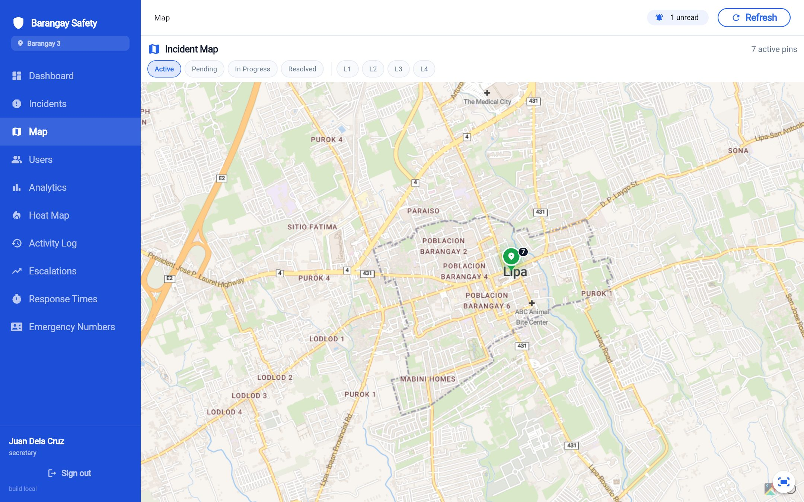
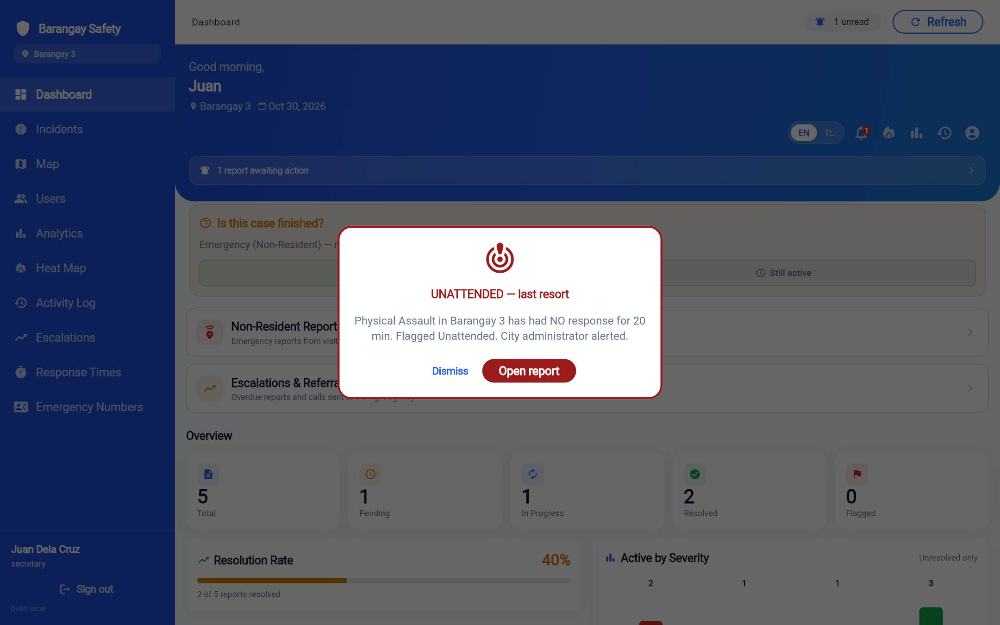

# Barangay Safety


**Incident reporting with geo-tagging and interactive maps for high-density barangays in Lipa City.**

Residents report incidents with GPS-tagged photos; barangay officials see them on a live map,
get escalating alerts when a report goes unanswered, and track how fast help arrives.

Capstone project · BSIT, Major in System Development · De La Salle Lipa · 2025–2026
Built end to end by **Ian Karvey L. Manimtim** — design, mobile app, web dashboard and backend.

**▶ Try the interactive demo:** [karveyportfolio.vercel.app/projects/barangay-safety](https://karveyportfolio.vercel.app/projects/barangay-safety/)
(a simulated resident app and barangay-hall dashboard with sample data)



---

## Screenshots

The barangay-hall web dashboard, running on sample data (`tool/web_demo`) — names and numbers are placeholders.

| Incident management | Incident map |
|---|---|
|  |  |

**Auto-escalation:** after 15 minutes with no response, the report is flagged *Unattended* and the city administrator is alerted.



## Features

- **Geo-tagged reports** — category, severity, photo or video, and the reporter's GPS location on a map. Reports queue offline and send when the signal returns.
- **Auto-escalation** — an unanswered report escalates at 5, 10 and 15 minutes, widening who is alerted each time, with after-hours rules for the officials on call. Runs on the server, so it works with every phone closed.
- **"I'm responding"** — an official claims a report in one tap; the resident is told help is on the way and the response clock stops.
- **Live maps and heatmaps** — every incident on an interactive map, hotspot heatmaps, and live responder tracking.
- **Duplicate and fake-report defence** — perceptual image hashing flags re-used photos; a trust score helps officials triage.
- **Analytics and exports** — response-time analytics, an audit log of official actions, and PDF / Excel exports.
- **Privacy by default** — row-level security on every table, private photo storage with short-lived signed URLs, ID verification and a privacy-consent flow.
- **Accessible** — English and Filipino, text-to-speech, and a practice-report tutorial.

Roles: **Resident**, **Barangay official** (Captain, Secretary, staff, tanod), **Non-resident** and **Super admin**.

## Tech stack

| Layer | Technology |
|---|---|
| Mobile app & web dashboard | Flutter, Dart, Provider, flutter_map, Geolocator, fl_chart |
| Database & auth | Supabase (PostgreSQL) with row-level security |
| Scheduled escalation | pg_cron + SQL functions |
| Push notifications | Supabase Edge Functions (TypeScript) + Firebase Cloud Messaging |
| Maps | OpenStreetMap data via Stadia Maps tiles |
| Hosting (web dashboard) | Firebase Hosting |

## Project structure

```
lib/
  config/      app-wide settings (keys come from env.json at build time)
  models/      data models
  providers/   state management
  screens/     resident, official, non-resident, super-admin and web screens
  services/    Supabase, notifications, escalation, offline queue, exports …
supabase/
  schema.sql             database schema
  migration_*.sql        incremental migrations, applied in date order
  functions/             edge functions (push notifications)
test/                    unit and widget tests
```

## Running it yourself

1. **Supabase** — create a project, run `supabase/schema.sql`, then the `migration_*.sql` files in date order.
2. **Firebase** (push notifications) — run `flutterfire configure` to generate
   `lib/firebase_options.dart` and `android/app/google-services.json` for your own Firebase project.
3. **Keys** — copy `env.example.json` to `env.json` and fill in your Supabase URL, publishable key and Stadia Maps key.
   `env.json` is git-ignored.
4. **Run**
   ```bash
   flutter pub get
   flutter run --dart-define-from-file=env.json          # mobile
   ./deploy_web.sh                                       # web dashboard → Firebase Hosting
   ```
5. **Edge functions** — deploy `supabase/functions/*` and set `FIREBASE_PROJECT_ID`,
   `FIREBASE_SERVICE_ACCOUNT` and `WEBHOOK_SECRET` as function secrets.

No credentials are stored in this repository.

---

© 2026 Ian Karvey L. Manimtim
